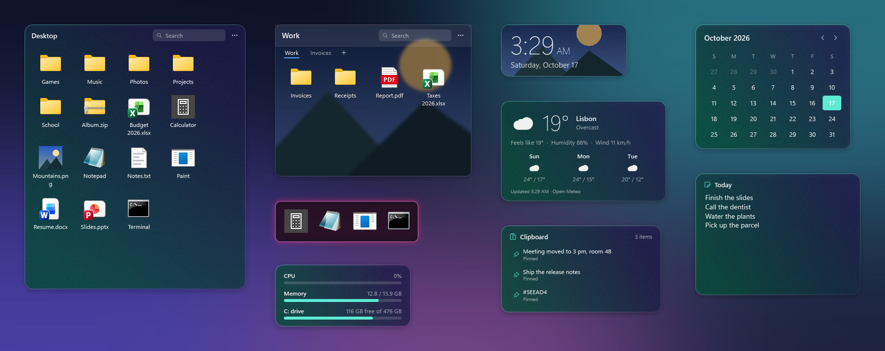
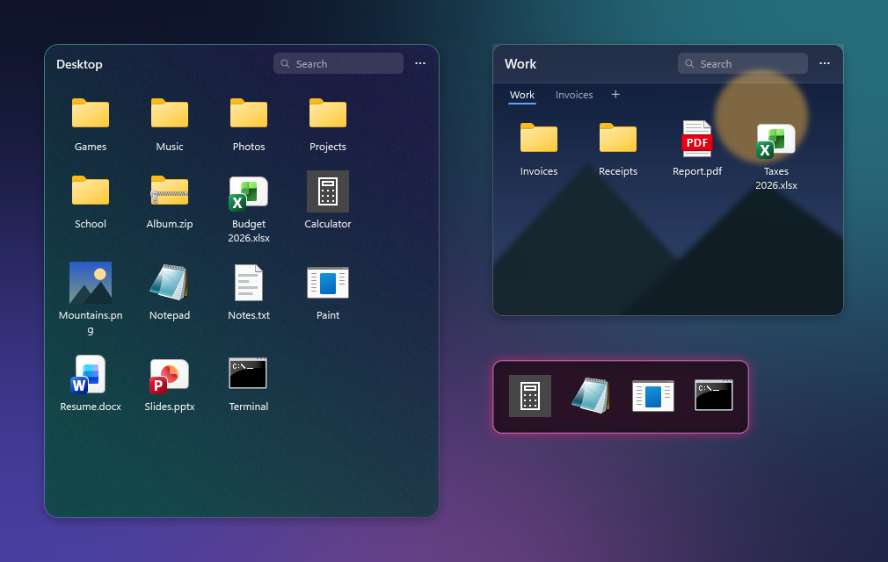
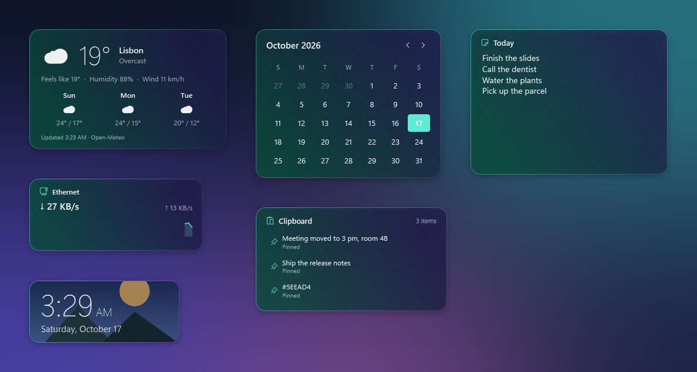
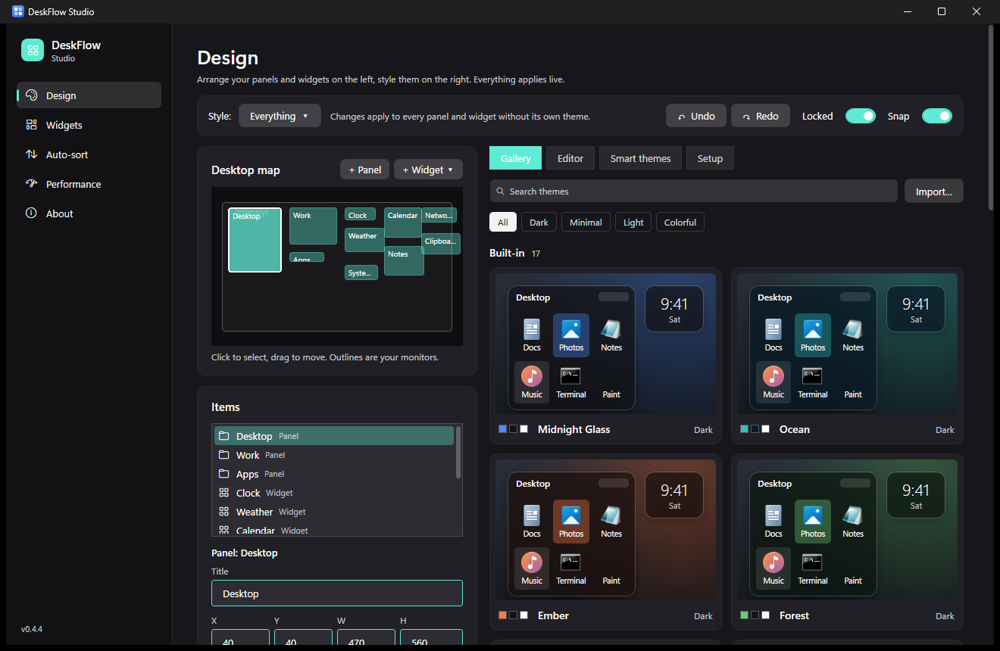
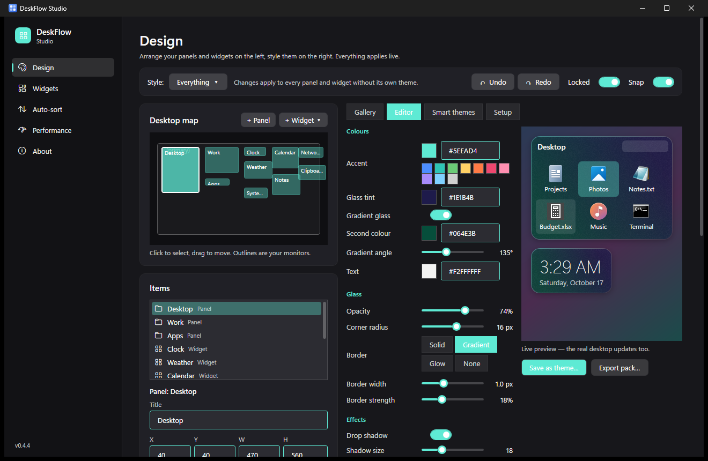

# DeskFlow

**Your Windows desktop, arranged.**

Glass panels and widgets that live right on your wallpaper — and still behave like real desktop icons.

 

### [⬇ Download the latest version](https://github.com/Silverfox0338/DeskFlow-Releases/releases/latest)

---

## Why I made DeskFlow

My desktop was a wall of icons. Every download, shortcut and screenshot landed in the same grid, and
I could never find anything. I wanted the order of an app launcher without giving up the things
that make the desktop useful — double-clicking files, dragging them into Discord, right-clicking for
"Open with". And I didn't want to lose my animated Wallpaper Engine background in the process.

So I built DeskFlow: a layer that sits on top of your wallpaper and underneath your apps, where you
arrange your real files into scrollable glass panels and put useful widgets wherever you like.

## Features

**Panels that hold your real files**
- Show your Desktop (or any folders) in scrollable, searchable glass panels.
- Everything still works like real icons: double-click to open, the full Windows right-click menu
  (Send to, Open with…), drag files in and out, rename with F2, delete to the Recycle Bin.
- New files appear instantly. Sort by name, type or date; four icon sizes; collapse a panel to its header.
- **Tabs** inside a panel (Desktop, Paperwork, Projects…), a compact **dock mode**, and a **theme per panel**.
- **Auto-sort rules** keep things tidy for you — e.g. new screenshots go straight to Pictures\Screenshots,
  installers to Downloads\Installers. Nothing is ever overwritten.

**Widgets**
- **Weather** with a 3-day forecast, **Calendar**, **Clock**, **Notes** that save as you type,
  **Now Playing** with media controls, **System stats**, **Network & battery** with a live speed graph,
  **Clipboard history** (private and in-memory only), and a **Quick launch** bar for your favourite apps.
- Browse and add them from the widget gallery in DeskFlow Studio.
- Widgets pause automatically when they're hidden behind your apps — just like Wallpaper Engine does —
  so DeskFlow uses close to zero CPU while you work.

**DeskFlow Studio**
- A full editor for your layout: a live map of your monitors, exact positions, grid size and snapping.
- Live grid snapping and **smart guides** that line things up with each other while you drag
  (hold <kbd>Alt</kbd> to place freely, <kbd>Esc</kbd> to cancel), plus **undo/redo** for every layout change.
- **Monitor profiles**: plug in your second screen and your two-monitor layout comes back by itself.
- A **peek hotkey** that brings your whole desktop layer above every window, and back again.
- **Export and import layouts** to move your setup to another PC.
- **Design workspace**: arrange and style in one place, with the theme gallery, editor and smart
  themes right next to your layout.

**Themes that are actually yours**
- **17 built-in themes** in a gallery where every card is a live preview, plus themes generated from
  your **wallpaper's colours**.
- A pro **theme editor** with a large live preview: gradient glass, solid, gradient or glowing borders,
  shadows, hover and selection styles, fonts and text sizes, density, header styles and widget scale.
- **Your own images** behind panels and widgets, with visibility, blur and darken controls, plus
  subtle textures (noise, paper, carbon and more). Give a single widget its own photo, too.
- **Smart themes** follow Windows light/dark mode or switch between a day and a night theme on a
  schedule, and can use your Windows accent colour.
- Share a look as a **theme pack** (`.deskflow-theme`), with its images included.

  

**Plays nicely with Windows**
- Stays under your apps, comes forward with <kbd>Win</kbd> + <kbd>D</kbd>.
- Works with Wallpaper Engine and survives Explorer restarts.
- Hides the native desktop icons while it runs and puts them back when it closes.
- Per-monitor DPI aware, single tray icon, starts with Windows if you want it to.
- Updates itself: DeskFlow checks for new versions and installs them with one click.

## Install

1. Download **`DeskFlow-Setup-<version>.exe`** from the [latest release](https://github.com/Silverfox0338/DeskFlow-Releases/releases/latest).
2. Run it. It installs just for you — no administrator prompt.
   If your PC doesn't have the .NET 10 Desktop Runtime yet, the installer downloads it from Microsoft for you.
3. DeskFlow starts in your system tray (look for the blue tile icon near the clock — it may be under the **^** arrow).

Each release also includes a `.sha256` file if you'd like to verify your download.

## Getting started

- **Right-click the tray icon** for everything: add panels and widgets, lock/unlock the layout, themes, settings.
- **Unlock the layout** to move things around — drag a panel by its header and resize it from the corner.
  Double-click the tray icon to toggle the lock quickly.
- Open **DeskFlow Studio** from the tray for exact positioning, grid options and the theme gallery and editor.
- Right-click a panel's empty space for New folder, Paste, Sort by and Icon size; right-click a widget for its settings.

## Requirements

- Windows 11, or Windows 10 version 2004 or newer (64-bit)
- [.NET 10 Desktop Runtime](https://dotnet.microsoft.com/download/dotnet/10.0) — installed automatically if it's missing

## Privacy

DeskFlow runs entirely on your PC. Your layout and themes are stored in `%AppData%\DeskFlow`.
The only network request it makes on its own is a daily check of this page for new versions
(you can turn that off in Studio → About). Nothing is collected or sent to me.

## Uninstall

Use **Settings → Apps → Installed apps → DeskFlow → Uninstall**. DeskFlow closes, your normal desktop
icons come back, and you're asked whether to keep your layout and themes.

## Feedback

Found a bug or have an idea? [Open an issue](https://github.com/Silverfox0338/DeskFlow-Releases/issues) —
I read all of them. Screenshots and your Windows version help a lot.

## Credits

DeskFlow is designed and developed by **[Silverfox0338](https://github.com/Silverfox0338)**.
It's built on .NET and WPF by Microsoft, and the installer is made with Inno Setup by Jordan Russell and
Martijn Laan. DeskFlow is an independent project and isn't affiliated with Wallpaper Engine or Microsoft.

## License

Copyright © 2026 Silverfox0338. All rights reserved.
DeskFlow is free to download and use; see [LICENSE.md](LICENSE.md) for the full terms.

Made with care by Silverfox0338

